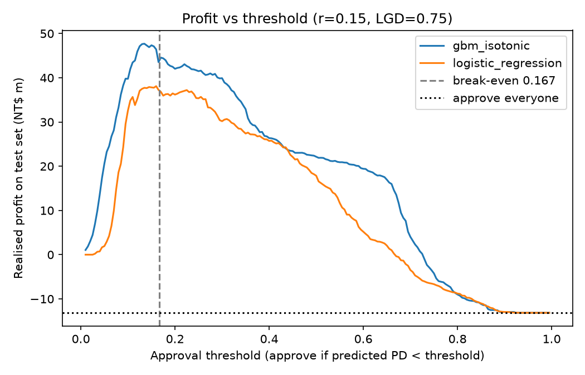
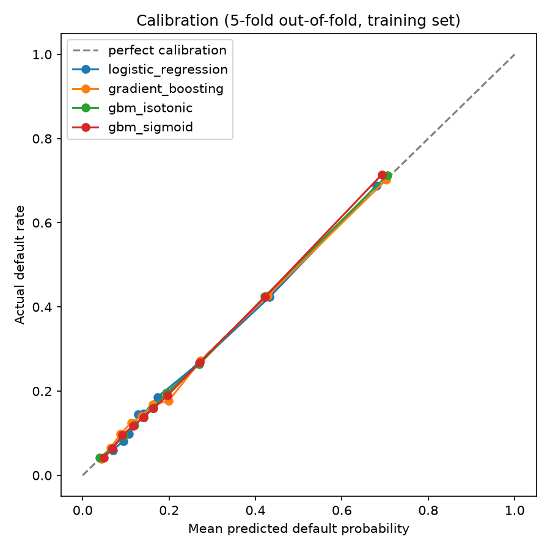
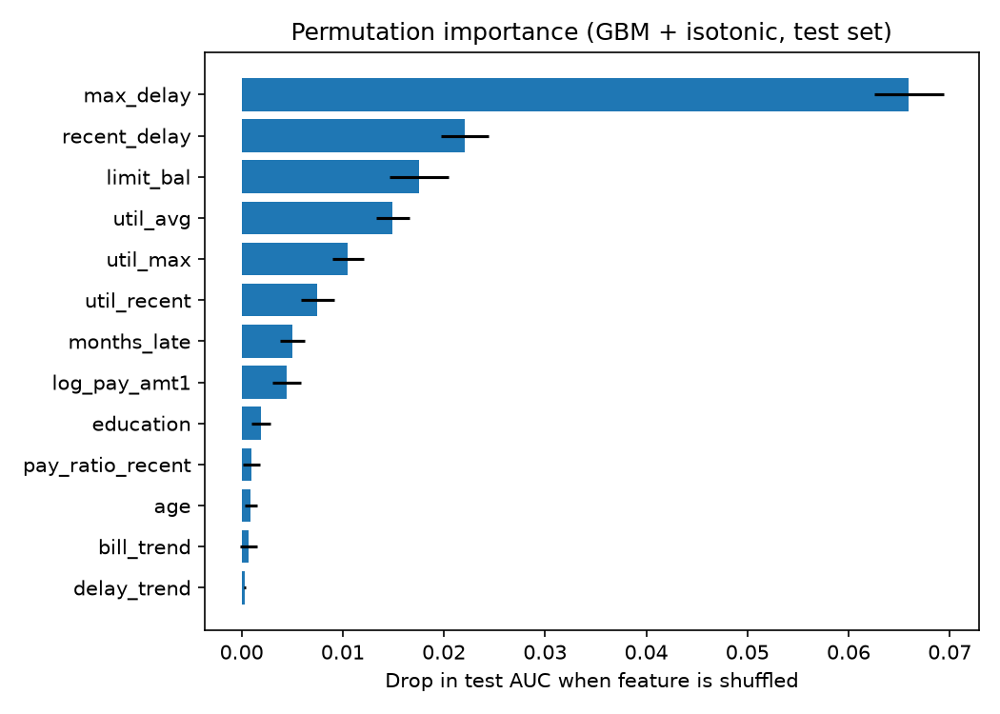

# Credit risk decisioning

**Where should a card lender draw the approval line?** This project predicts the probability that a credit-card client defaults, then turns that probability into a profit-maximising approve/decline rule, with an interactive app to explore the trade-off.

**Live app:** [credit-risk-decisioning-ht.streamlit.app](https://credit-risk-decisioning-ht.streamlit.app/)



## Results (6,000 held-out clients)

| | AUC | Brier |
|---|---|---|
| **Gradient boosting + isotonic calibration** | **0.778** | **0.135** |
| Logistic regression (benchmark) | 0.749 | 0.141 |

Base-case economics: net margin r = 0.15, loss given default LGD = 0.75, exposure = credit limit. Approve when predicted PD < r / (r + LGD) = 0.167.

| Policy | Profit (NT$ m) | Approved | Default rate among approved |
|---|---|---|---|
| Approve everyone | −13.1 | 100% | 22.1% |
| Logistic regression rule | 37.4 | 65.8% | 12.1% |
| **Gradient boosting rule** | **44.4** | **56.9%** | **10.6%** |

- The model turns a loss-making approve-all policy into a profitable one, roughly halving the default rate among approved clients.
- The break-even rule is set from the assumptions alone, without looking at test outcomes. It captured 93% of the best profit achievable on the test set (47.7m at a threshold of 0.135).
- Across a 3×3 sensitivity grid (r ∈ {0.10, 0.15, 0.20}, LGD ∈ {0.45, 0.75, 0.90}), the rule stayed within 91% of the test-set optimum. The absolute profit varies widely with the assumptions; the decision rule is the robust part.

## Data

UCI [Default of Credit Card Clients](https://archive.ics.uci.edu/dataset/350/default+of+credit+card+clients) (Yeh & Lien, 2009): 30,000 card clients of a Taiwanese bank, April–September 2005 repayment history, default in October 2005 (22.1%). Licensed CC BY 4.0. The data is downloaded in code and **never committed** to this repository.

## Method

1. **Load:** `ucimlrepo` → DuckDB, with readable column names and null checks (`src/load_data.py`).
2. **EDA:** undocumented category codes, negative bills, over-limit balances and skewed payments; findings and a cleaning plan recorded before any modelling (`notebooks/eda_1.ipynb`).
3. **Features in SQL:** 13 behaviour features (worst and recent delay, months late, utilisation, repayment ratio, debt and delay trends) built from the raw table, which is never modified (`sql/features.sql`).
4. **Split:** 80/20 stratified on default, stored as a table so every later step uses the same clients (`src/split_data.py`).
5. **Models:** 5-fold CV on the training set. Gradient boosting (AUC 0.781 ± 0.007) beat logistic regression (0.768 ± 0.009) in every fold. For logistic regression only, delays are capped at 3 and utilisation is clipped at the training 99th percentile, inside the pipeline so nothing leaks between folds (`src/pipelines.py`, `src/cv_compare.py`).
6. **Calibration:** all models were within 1 percentage point on average; isotonic calibration halved the gradient boosting model's calibration error (ECE 0.0062 → 0.0032) and was chosen (`src/calibration.py`).
7. **Decision rule:** expected profit per client = (1 − PD)·r·EAD − PD·LGD·EAD, evaluated once on the held-out test set (`src/profit_threshold.py`).
8. **Explainability and fairness** (`src/explain_fairness.py`).



## What drives the model



Repayment history dominates: shuffling `max_delay` cuts test AUC by 0.066, three times more than any other feature. Credit limit and utilisation come next. Correlated features such as `months_late` score low here because `max_delay` carries the same information; permutation importance measures unique contribution.

## Fairness

Sex and marital status are protected characteristics under the UK Equality Act 2010, so they are **excluded from the model** and audited separately at the 0.167 threshold:

| Group | Actual default | Mean predicted | Approved | Approval ratio |
|---|---|---|---|---|
| Female (3,598) | 21.3% | 21.8% | 57.8% | 1.00 |
| Male (2,402) | 23.4% | 22.9% | 55.5% | 0.96 |
| Married (2,767) | 24.1% | 22.4% | 57.5% | 1.00 |
| Single (3,158) | 20.5% | 22.0% | 56.5% | 0.98 |

All approval ratios are above the 0.8 screening level, and the model is calibrated within each sex. It under-predicts risk for married clients and over-predicts it for single clients by about 1.5 percentage points, a likely proxy effect through other features, which would need monitoring in production. The "other" marital group (75 clients) is too small to assess.

## Limitations

- One bank, one country, 2005: patterns may not transfer to current UK lending.
- Simplified economics: exposure = credit limit, a single period, and illustrative values for r and LGD.
- One-month default horizon, whereas real affordability and IFRS 9 models look 12 months ahead or over a lifetime.
- No reject inference: only clients the bank had already approved are observed.

## How to run

```bash
conda create -n credit-risk python=3.11 -y
conda activate credit-risk
pip install -r requirements.txt

python run_pipeline.py      # download data, build features, train, evaluate
streamlit run app.py        # interactive app
```

The trained models are included in `models/`, so the app can be run directly; it downloads the data and builds the database on first start.

## Project structure

```
app.py                  Streamlit app
run_pipeline.py         runs every step in order
sql/features.sql        feature engineering in DuckDB
src/                    load, split, models, calibration, profit rule, fairness
notebooks/eda_1.ipynb   exploratory analysis and cleaning plan
models/                 saved models and metadata
reports/                plots used in this README
```

## Citation

Yeh, I.-C., & Lien, C.-H. (2009). The comparisons of data mining techniques for the predictive accuracy of probability of default of credit card clients. *Expert Systems with Applications*, 36(2), 2473–2480.
